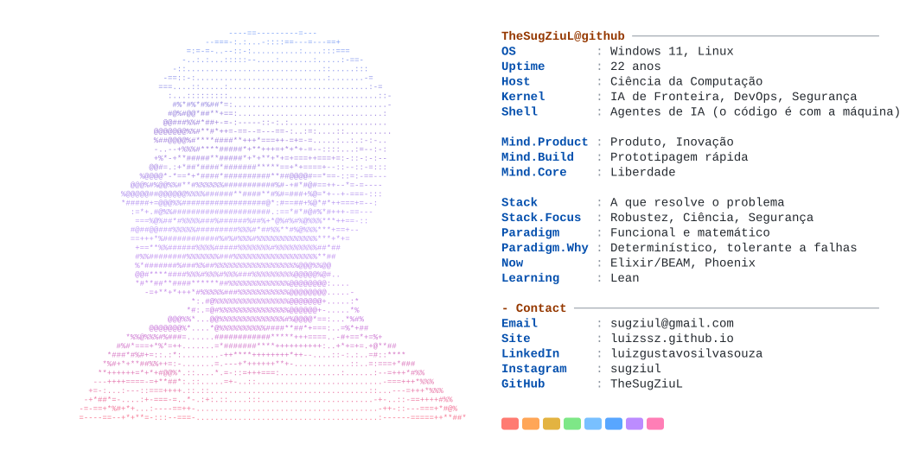

<a href="https://luizssz.github.io/">
  <picture>
    <source media="(prefers-color-scheme: dark)" srcset="dark_mode.svg">
    
  </picture>
</a>

  
  
  
  

  
  
  
  

💡 Eu penso o produto. A máquina escreve o código.

